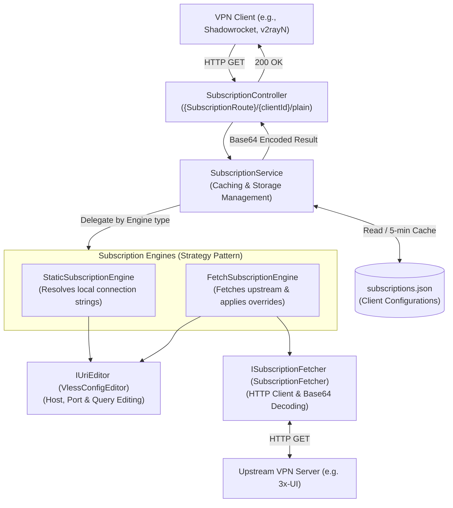

# Architecture & System Design

`vpn-simple-subscription` is a lightweight .NET 10 ASP.NET Core service that delivers VPN client subscriptions (compatible with Shadowrocket, v2rayN, Sing-box, Clash, etc.).

---

## 1. High-Level Architecture & Request Flow

The service exposes HTTP endpoints matching `{SubscriptionRoute}/{clientId}/plain`. When a VPN client requests an update, the service resolves the client's configuration, encodes the resulting newline-delimited VLESS URIs in Base64, and returns the response.



---

## 2. Core Components & Responsibilities

### 2.1. `SubscriptionService`
* **Storage & Caching**: Reads `subscriptions.json` from the path configured in `AppSettings.SubscriptionStorageDiscoveryPath`. Employs a thread-safe double-checked lock with `SemaphoreSlim` and a 5-minute TTL to minimize disk I/O.
* **Orchestration**: Resolves the client entry matching `clientId`, delegates config generation to the appropriate `ISubscriptionEngine`, joins the resulting configs with newline characters (`\n`), and returns the Base64-encoded payload.

### 2.2. Engine Strategy Pattern (`ISubscriptionEngine`)
Different client profiles require different resolution strategies. The Strategy pattern decouples `SubscriptionService` from the specific resolution logic:

* **`StaticSubscriptionEngine`** (`engine: "static"` or omitted):
  * Resolves handcrafted connection strings configured under `connections`.
  * Supports optional `Host` and `Port` overrides per connection via `IUriEditor`.
* **`FetchSubscriptionEngine`** (`engine: "fetch"`):
  * Resolves dynamic configurations from an upstream subscription URL (e.g., 3x-UI) via `ISubscriptionFetcher`.
  * Splits multi-node upstream responses into individual VLESS URIs.
  * Evaluates `overrides` to selectively match nodes by `matchSni` or `matchHost`.
  * Applies targeted `Host`, `Port`, and `Title` replacements using `IUriEditor`.

### 2.3. Supporting Abstractions
* **`IUriEditor` / `VlessConfigEditor`**:
  * Adheres strictly to RFC 3986 URI conventions.
  * Safely modifies `Host`, `Port`, and query parameters (such as `sni`) without corrupting UUIDs, URL-encoded parameters, or complex JSON inside `extra`.
* **`ISubscriptionFetcher` / `SubscriptionFetcher`**:
  * Fetches upstream subscription endpoints via `IHttpClientFactory`.
  * Decodes Base64 or plain HTTP response bodies into a list of VLESS configurations.
  * Parses metadata headers: `Profile-Title`, `Profile-Update-Interval`, and `Subscription-Userinfo`.
* **`ConnectionLineFormatter`**:
  * Centralizes node remark/fragment formatting (`connectionString#Title`), replacing existing fragments cleanly when titles are overridden.

---

## 3. Configuration Schema (`subscriptions.json`)

The storage file contains a JSON array of client subscription objects. A client defines either a `static` profile or a `fetch` profile.

### 3.1. Static Engine Profile
```json
{
  "clientId": "static-user",
  "engine": "static",
  "connections": [
    {
      "title": "Direct Node",
      "connectionString": "vless://00000000-0000-0000-0000-000000000000@example.com:443?type=tcp"
    },
    {
      "title": "Redirected Node",
      "connectionString": "vless://00000000-0000-0000-0000-000000000000@example.com:443?type=tcp",
      "host": "custom.example.com",
      "port": 8443
    }
  ],
  "notes": "Static profile with multiple connections"
}
```

### 3.2. Fetch Engine Profile (with SNI & Host Matching)
```json
{
  "clientId": "dynamic-user",
  "engine": "fetch",
  "subscriptionUrl": "https://example.com:8802/sub/test123",
  "overrides": [
    {
      "matchSni": "topicboard.app",
      "title": "Reality CDN Node",
      "host": "reality-proxy.example.com",
      "port": 443
    },
    {
      "matchHost": "ad.small-biz.org",
      "title": "Plain XHTTP Node",
      "host": "plain-proxy.example.com",
      "port": 443
    }
  ],
  "notes": "3x-UI upstream subscription with targeted node overrides"
}
```

---

## 4. Dependency Injection & Service Lifetimes

All application services and strategy engines are registered with **Singleton** lifetimes in `Program.cs`. External HTTP communication is managed via `IHttpClientFactory` to avoid captive dependencies and handler socket exhaustion:

```csharp
builder.Services.AddHttpClient();
builder.Services.AddSingleton<IUriEditor, VlessConfigEditor>();
builder.Services.AddSingleton<ISubscriptionFetcher, SubscriptionFetcher>();
builder.Services.AddSingleton<ISubscriptionEngine, StaticSubscriptionEngine>();
builder.Services.AddSingleton<ISubscriptionEngine, FetchSubscriptionEngine>();
builder.Services.AddSingleton<ISubscriptionService, SubscriptionService>();
```
